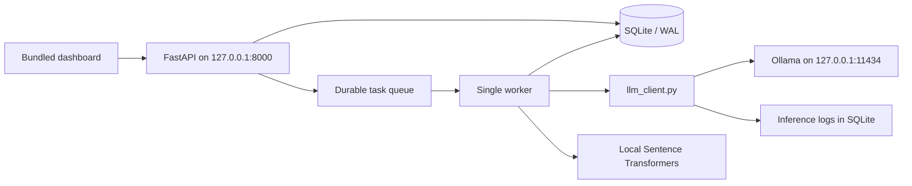

# Local architecture

## Runtime modules

- `config.py`: fixed loopback inference endpoint, allowlisted model tags, local file paths and enforced offline embedding settings.
- `db.py`: SQLite schema, WAL, foreign keys, transaction helpers and input invalidation.
- `seed.py`: sample input data only; two products, twelve prospects per product, five reply threads per product.
- `schemas.py`: request validation and strict output schemas.
- `llm_client.py`: the sole HTTP inference client, schema submission, validation retries and per-attempt audit logging.
- `embeddings.py`: lazy, CPU-only loading of a local embedding checkpoint and normalised cosine similarity.
- `workflows.py`: prerequisite graph, durable queue, serial execution, output persistence and stale-result protection.
- `hardware.py`: RAM/CPU detection, best-effort NVIDIA detection and conservative model recommendation.
- `app.py`: REST API, local security headers, product scoping, exports, lifecycle and static assets.
- `web/`: buildless HTML/CSS/JavaScript with locally bundled fonts. No CDN, analytics, web fonts fetched at runtime, or third-party UI scripts.

## Data model

`products` owns company information, product information, an input revision and generated business profile. `icps` stores one current ICP per product. `prospects` owns input notes and generated research, problem, score and embedding similarity. `signals` and `emails` reference prospects through composite `(prospect_id,product_id)` foreign keys. `replies` also has that composite reference. `task_queue` stores workflow identity, product revision, model snapshot, explicit dependency IDs, attempts, result, error and timing. `inference_logs` records each actual generation attempt. `settings` stores the selected local model.

Every read/write of prospect-level data includes product ID. The API rejects requested IDs from another product before enqueuing any work. Database constraints also prevent cross-product child rows.

## Execution

Profile -> ICP -> research -> signals -> problem -> scoring -> email. Reply classification is independent. The full pipeline includes both branches. Individual workflows reuse saved prerequisites when available; otherwise they enqueue missing prerequisites. Repeated clicks reuse pending matching tasks. Completed results are not used as a substitute for a requested new generation.

Only one task runs at a time to prevent CPU/memory contention. Queue state is committed before inference. Model unavailability sets waiting state with a ten-second delay, without changing source data. On app restart, previously running work is returned to queued and interrupted log entries are marked accordingly. Schema-invalid output fails after three attempts. A failed prerequisite blocks its descendants. Retrying a failed task lets blocked descendants be reconsidered.

Editing a product or existing prospect invalidates generated product outputs and cancels queued/in-flight work for that revision. The persistence transaction rejects results that arrive after cancellation or an input revision change. Successful regeneration of an intermediate stage clears downstream output that would otherwise be stale. Historical task results and logs remain available as evidence.

## Offline boundary

Setup scripts perform explicit downloads. The app does not run those scripts. The inference client ignores proxy environment variables and refuses redirects. It only submits allowlisted model tags to a fixed loopback endpoint. The portable runtime is launched with cloud features disabled. Embedding runtime sets offline flags before importing the model library and loads an explicit local path.

All dashboard assets are served from the same process. CSP permits only same-origin connections. No actual sending, scraping or external data enrichment is wired into the local application.

The SQLite database is not encrypted. The app has no user authentication and must remain bound to loopback. The OneDrive folder may be synchronised by the OS independently of application behavior; use a non-synchronised directory for strict machine-only storage.

## API

Interactive endpoint documentation is at `/api/docs`. Key paths:

- `GET /api/status`, `PUT /api/model`
- `GET/POST /api/products`, `PUT /api/products/{id}`
- `GET /api/products/{id}/workspace`
- `POST /api/products/{id}/prospects`, `PUT /api/products/{id}/prospects/{prospect}`
- `POST /api/products/{id}/replies`
- `POST /api/products/{id}/run`
- `POST /api/products/{id}/tasks/{task}/retry`
- `POST /api/products/{id}/tasks/cancel`
- `GET /api/products/{id}/logs`
- `GET /api/products/{id}/export/{prospects|logs|workspace}`

Deployment uses one Uvicorn worker only. Database migrations currently have schema version 1; future schema changes must introduce explicit migrations before changing existing files.
